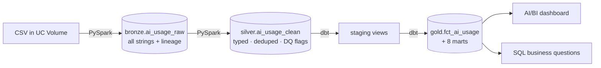

# AI Usage & Impact Analytics

An end-to-end **lakehouse data-engineering project** built on a survey of 300 students and professionals and
how they use AI tools (ChatGPT, Gemini, Copilot, Claude …).

A messy CSV is ingested and cleaned with **PySpark**, modelled and tested with **dbt** and **SQL** on
**Databricks** (Unity Catalog + Delta), orchestrated as a **Databricks Job** and visualised in a **Databricks AI/BI dashboard**.
The same code also runs entirely on a laptop (PySpark local mode + dbt on DuckDB), which is what CI uses.



## Highlights

* **Medallion architecture** on Unity Catalog: `raw` (volume) → `bronze` → `silver` → `staging` → `gold`.
* **PySpark cleaning library** shared by Databricks notebooks and the local runner (`src/ai_usage_pipeline`).
* **dbt project** with reusable macros, a multilingual job-family classifier, and **38 data tests**.
* **One codebase, two engines**: dbt models run unchanged on Databricks SQL and DuckDB.
* **Databricks Asset Bundle** deploys a serverless job (bronze → silver → `dbt build`) and the dashboard.
* **AI/BI dashboard as code**: 3 pages, 13 charts and global filters, deployed by the same bundle.
* **CI** on GitHub Actions: lint, unit tests, and the full pipeline on every push.

## Tech stack

| Layer | Tool | Where |
|---|---|---|
| Storage / compute | Databricks: Unity Catalog, Delta Lake, serverless SQL warehouse | `databricks/` |
| Ingestion & cleaning | PySpark | `src/ai_usage_pipeline/`, `databricks/notebooks/` |
| Modelling & data tests | dbt (`dbt-databricks`, `dbt-duckdb` locally) | `dbt/` |
| Analysis | SQL | `sql/business_questions.sql` |
| Orchestration | Databricks Job via Asset Bundle | `databricks.yml`, `databricks/resources/` |
| BI | Databricks AI/BI dashboard (runs in the browser, works on any OS) | `dashboards/` |
| Quality | pytest, ruff, GitHub Actions | `tests/`, `.github/workflows/ci.yml` |

## Business questions & findings

| # | Question | Finding |
|---|---|---|
| Q1 | Which AI tools are most popular? | **ChatGPT leads with 41%** of users, then Gemini (14%) and Copilot (12%). |
| Q2 | Which tools deliver the best experience? | **Gemini and Claude** have the highest net-recommend score (about +49); Meta AI is lowest (0). |
| Q3 | For which purposes does AI save the most time? | **Writing (students)** and **office work (professionals)**, ~7.5 h/week. |
| Q4 | Does more daily use mean more value? | Yes. **6+ h/day users save ~14.5 h/week** vs ~1.9 h for <1 h/day (r = 0.90). |
| Q5 | Do paying users get more value? | Not in satisfaction: **free users recommend more** (+44) than $1-20 plans (+14 to +28). |
| Q6 | How does adoption differ by country? | ChatGPT is the top tool in every country; India, US and Canada have the most users. |
| Q7 | Which job families benefit most? | Humanities students and admin/operations staff save the most time (~7.5 h/week). |
| Q8 | Which metrics move together? | Usage ↔ time saved (0.90), usage ↔ productivity (0.78), productivity ↔ satisfaction (0.66). |
| Q9 | How clean was the data? | 12 duplicates, mixed units, 17 tool spellings and implausible outliers were fixed (see below). |

> With 288 respondents, treat segments of fewer than ~10 people as indicative only.

## Dashboard

The [AI/BI dashboard](dashboards/ai_usage_analytics.lvdash.json) reads the `gold` tables directly on the SQL warehouse.

| Page | Contents |
|---|---|
| **Overview** | KPIs (respondents, productivity, hours saved, recommend rate) · tool popularity (Q1) · net recommend score by tool (Q2) · hours saved and productivity by daily usage (Q4) |
| **Value & Segments** | hours saved by purpose (Q3) · free vs paid plans (Q5) · countries (Q6) · job-family heat-map (Q7) |
| **Drivers & Data Quality** | correlation heat-map (Q8) · what the pipeline fixed (Q9) |
| **Filters** | user type, country, AI tool and age group, applied to every page |

Charts share one dataset with reusable measures (e.g. *Net Recommend Score*), so clicking a bar cross-filters the
rest of the page. `tests/test_dashboard.py` checks the definition's structure in CI.

## Data cleaning (silver layer)

| Problem in the raw CSV | Fix |
|---|---|
| 12 exact duplicate rows | De-duplicated on a row hash and `User_ID` |
| Units inside numbers: `"28 yrs"`, `"2 hrs"`, `"$1,884"` | Regex strip and cast to `DOUBLE` |
| `Chat GPT`, `chatgpt`, `Copilot`, `gemini` … | Mapped to 8 canonical tool names |
| `M`, `MALE`, `f`, `FEMALE` · `U.K.`, `brazil` · `Masters`, `BA/BSc`, `Ph.D.` | Gender, country and education standardised |
| Age 97, 23 h/day AI use, 20 h/day work, income 250,000 | Set to `NULL` and flagged in `dq_*_out_of_range` |
| Blank values | `NULL` or `Unknown`, flagged in `dq_*_missing` |
| Professions in English, Portuguese, German and French | Grouped into 10 job families (dbt macro) |

## Data model (gold)

| Table | Grain | Purpose |
|---|---|---|
| `fct_ai_usage` | one row per user | All attributes, bands (age, usage, income, plan) and efficiency metrics. Main dashboard source. |
| `mart_tool_performance` | AI tool | Popularity, productivity, satisfaction, recommendation |
| `mart_purpose_impact` | purpose × user type | Time saved and productivity by purpose |
| `mart_usage_intensity` | usage band × user type | Outcomes by daily usage |
| `mart_plan_tier_value` | plan tier × user type | Free vs paid, cost per hour saved |
| `mart_country_summary` | country | KPIs and most-used tool |
| `mart_segment_summary` | segment × user type | Job family, education, age group, gender |
| `mart_metric_correlations` | metric pair | Pearson correlations (heat-map) |
| `mart_data_quality` | check | What the pipeline fixed |

Run `make dbt-docs` to browse column docs and the lineage graph.

## Project structure

```
├── data/raw/ai_usage_raw.csv          source dataset
├── src/ai_usage_pipeline/             PySpark bronze/silver transformations (shared library)
├── databricks/
│   ├── notebooks/                     00_setup.sql · 01_bronze_ingest.py · 02_silver_transform.py
│   └── resources/                     Databricks Job (bronze → silver → dbt) + dashboard
├── databricks.yml                     Databricks Asset Bundle
├── dbt/
│   ├── models/staging/                sources + stg_ai_usage
│   ├── models/intermediate/           int_ai_usage_enriched (bands, tiers, job families, efficiency)
│   ├── models/marts/                  fct_ai_usage + 8 marts
│   ├── macros/                        kpi_metrics · profession_category · safe_divide · schema naming
│   └── tests/                         generic value_between + singular tests
├── sql/business_questions.sql         one query per business question
├── dashboards/ai_usage_analytics.lvdash.json   AI/BI dashboard definition (deployed by the bundle)
├── scripts/                           local runner, SQL helper
├── tests/                             pytest unit tests
└── .github/workflows/ci.yml           lint + tests + full pipeline
```

## Run it locally

Requirements: **Python 3.10 to 3.12** and **Java 17** (needed by PySpark).

```bash
make setup      # create .venv and install dependencies
make test       # unit tests (PySpark cleaning rules + dashboard definition)
make pipeline   # PySpark -> dbt build with 38 data tests on DuckDB
```

`make help` lists all tasks. Without `make`, run `pip install -r requirements-dev.txt`, then `./scripts/run_all.sh`.

## Deploy to Databricks

Prerequisites: a Databricks workspace with Unity Catalog and a SQL warehouse (Free Edition works), plus
the [Databricks CLI](https://docs.databricks.com/dev-tools/cli/install.html).

```bash
databricks auth login --profile ai-usage
```

1. **Create the catalog objects.** Run `databricks/notebooks/00_setup.sql` in the workspace, or the same
   statements in the SQL editor. This creates catalog `ai_usage` with schemas `raw`, `bronze`, `silver`,
   `staging`, `gold` and the volume `raw.landing`.
2. **Upload the data:**
   ```bash
   databricks fs cp data/raw/ai_usage_raw.csv dbfs:/Volumes/ai_usage/raw/landing/ai_usage_raw.csv --profile ai-usage
   ```
3. **Deploy and run the job.** This deploys the job and the dashboard. The dbt task and the dashboard use
   the warehouse named *Serverless Starter Warehouse* by default; pass `--var warehouse_id=<id>` to use another one.
   ```bash
   make deploy
   make run-job
   ```
4. **Open the dashboard.** `databricks bundle summary --profile ai-usage` prints its URL. In the workspace it
   is listed under **Dashboards** as *AI Usage & Impact Analytics*.

To run dbt against Databricks from your laptop instead of the job, set the target and connection variables:

```bash
export DBT_TARGET=databricks DATABRICKS_HOST=<workspace-host> DATABRICKS_HTTP_PATH=<warehouse-http-path> DATABRICKS_TOKEN=<token>
cd dbt && dbt build --profiles-dir .
```

## Design notes

* **Why PySpark for silver and dbt for gold?** Parsing dirty text into typed columns is procedural and easy
  to unit-test in Python. Business modelling is declarative SQL that analysts can read, test and document in dbt.
* **Outliers are nulled, not dropped.** Each row keeps its other valid answers, and a `dq_*` flag records
  what was changed, so nothing disappears silently.
* **Portable SQL.** The models avoid engine-specific functions, so CI can test them on DuckDB without a
  Databricks workspace.

## Dataset

`data/raw/ai_usage_raw.csv` is a 300-row survey of AI-tool usage by students and professionals
(file name: *AI_Usage_and_Impact_on_Students_and_Professionals.csv*). It is included for reproducibility.
Check the dataset's original licence before reusing it outside this project.

## License

Code is released under the [MIT License](LICENSE).
